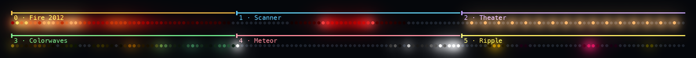
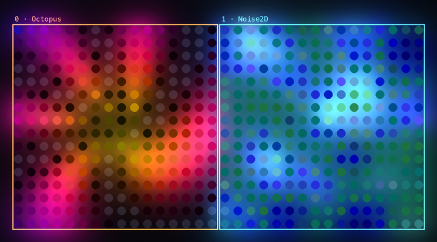

# LED Strip Simulator for WLED

See what a [WLED](https://github.com/wled/WLED) setup looks like before you touch the LEDs: split a strip or a 2D
matrix into segments, give each one an effect, a palette and colours, and copy the JSON straight to your WLED.

**[Open the simulator](https://djlex83.github.io/wled-strip-simulator/)** – a single web page, nothing to install.

## What it does

- **Strip:** number of LEDs (up to 1500), RGB or RGBW, master brightness and how many LEDs go in one row.
- **2D matrix:** switch the layout to *Matrix (2D)* and set width and height (up to 128 each, 4096 LEDs). Segments
  become rectangles with Start X/Stop X and Start Y/Stop Y. 1D effects are expanded like in WLED: *Pixels* (the
  matrix as one long strip), *Bar* (rows from the bottom), *Arc* (quarter circles from a corner) or *Corner*
  (L shapes). The JSON carries `startY`, `stopY` and `m12`; the matrix size itself is set in WLED under
  *Config → 2D Configuration*.
- **Segments:** split the strip into equal parts or set start and stop yourself. Each segment has its own effect,
  sliders, checkboxes, colours, palette, brightness, *reverse* and on/off, labelled like in the WLED app.
- **JSON for WLED:** the page writes the state as JSON. Send it to `POST /json/state` on your WLED, or put it into a
  preset. Effects and palettes carry their WLED numbers.
- **Import:** paste the result of `http://<your-wled>/json/state` (or an entry of `presets.json`) to see your current
  setup.
- **Share:** the whole setup lives in the page address. *Copy link* gives you a link that opens exactly this strip,
  these segments and these settings, for example to send it to someone or to keep it as a bookmark.
- **Like the real thing:** effects run at 42 frames per second like WLED, and gamma 2.8 is applied to every pixel like
  in WLED 16. A screen cannot show the brightness of real LEDs, so take the colours as an impression.
- English and German.

## Effects

96 WLED effects, written in JavaScript after the WLED 16 source code. The number is the effect ID in WLED.
The 46 effects added last, and the colour maths all effects share, were also checked against the original WLED
C++ code compiled on a computer: with the same settings and random numbers they give the same pixels, frame by frame.

**For strips (and on a matrix as expanded 1D effects), 65:**

| ID | Effect | ID | Effect | ID | Effect | ID | Effect |
| --: | :-- | --: | :-- | --: | :-- | --: | :-- |
| 0 | Solid | 28 | Chase | 59 | Multi Comet | 91 | Bouncing Balls |
| 1 | Blink | 30 | Chase Rainbow | 63 | Pride 2015 | 92 | Sinelon |
| 2 | Breathe | 33 | Rainbow Runner | 64 | Juggle | 93 | Sinelon Dual |
| 3 | Wipe | 34 | Colorful | 65 | Palette | 95 | Popcorn |
| 8 | Colorloop | 35 | Traffic Light | 66 | Fire 2012 | 96 | Drip |
| 9 | Rainbow | 38 | Aurora | 67 | Colorwaves | 97 | Plasma |
| 10 | Scan | 40 | Scanner | 68 | Bpm | 98 | Percent |
| 11 | Scan Dual | 41 | Lighthouse | 74 | Colortwinkles | 100 | Heartbeat |
| 12 | Fade | 43 | Rain ≈ | 75 | Lake | 101 | Pacifica |
| 13 | Theater | 45 | Fire Flicker | 76 | Meteor | 102 | Candle Multi |
| 14 | Theater Rainbow | 46 | Gradient | 79 | Ripple | 104 | Sunrise |
| 15 | Running | 47 | Loading | 80 | Twinklefox ≈ | 107 | Noise Pal |
| 16 | Saw | 50 | Two Dots | 85 | Spots | 108 | Sine |
| 17 | Twinkle | 52 | Running Dual | 87 | Glitter | 113 | Washing Machine |
| 18 | Dissolve | 55 | Tri Wipe | 88 | Candle |  |  |
| 20 | Sparkle | 57 | Lightning | 89 | Fireworks Starburst ≈ |  |  |
| 23 | Strobe | 58 | ICU | 90 | Fireworks 1D ≈ |  |  |

**For 2D matrices, 31:**

| ID | Effect | ID | Effect | ID | Effect | ID | Effect |
| --: | :-- | --: | :-- | --: | :-- | --: | :-- |
| 114 | Rotozoomer | 126 | Octopus | 162 | Pulser | 176 | Lissajous |
| 118 | Spaceships | 127 | Waving Cell | 164 | Drift | 177 | Frizzles |
| 119 | Crazy Bees | 146 | Noise2D | 166 | Sun Radiation | 178 | Plasma Ball |
| 120 | Ghost Rider | 149 | Firenoise | 167 | Colored Bursts | 180 | Hiphotic |
| 121 | Blobs | 150 | Squared Swirl | 168 | Julia | 181 | Sindots |
| 123 | Drift Rose | 152 | DNA | 172 | Game Of Life | 182 | DNA Spiral |
| 124 | Distortion Waves | 153 | Matrix | 173 | Tartan | 183 | Black Hole |
| 125 | Soap | 154 | Metaballs | 174 | Polar Lights |  |  |

≈ marks approximations: they look like the WLED effect but do not follow its code step by step. Effects with random
parts never repeat exactly, on the strip or here.

**Palettes:** Default, \* Colors Only, Party, Cloud, Lava, Ocean, Forest, Rainbow, Rainbow Bands, Sunset, Beech, Fire, Aurora, Atlantica, Temperature, Red Flash, Traffic Light, with the same colour values as WLED 16.
*Default* means the effect's own default palette, like in WLED.

When you import a state with an effect or palette the simulator does not have, it shows that segment as *Solid* or
with the *Default* palette and tells you which numbers it skipped. A state with `startY`/`stopY` (or the matrix size
from `/json/info`) switches the simulator to the matrix layout. The *Pinwheel* expansion of WLED is not simulated.

Good to know:
- Ghost Rider (120) and Blobs (121) exist in WLED builds without the particle system, such as ESP8266 builds; ESP32
  builds offer *PS Ghost Rider* and *PS Blobs* instead, which are not simulated.
- On a matrix with *Bar*, WLED runs Bouncing Balls, Popcorn, Drip and Fire 2012 once per column. The simulator runs
  them as one strip spread over the rows.

## Running it locally

[`index.html`](index.html) is the whole simulator: one file with no build step and no external libraries. Open it in
a browser or serve the folder with any static web server.

## Licence

[EUPL-1.2](LICENSE), the same licence as WLED, because the effects follow the WLED source code. The colour maths
follows WLED's slimmed-down FastLED functions.

This is an independent project. It is not part of WLED and not endorsed by the WLED team.
